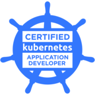
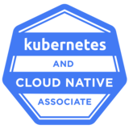

# Hi, I'm Prateek Jain

**DevSecOps Architect at Tech Alchemy & Hashirai · CNCF Kubestronaut · Pune, India**

I design secure delivery pipelines, Kubernetes platforms, and cloud infrastructure that help teams ship faster without making production fragile. My day-to-day sits across CI/CD, infrastructure as code, observability, supply-chain security, and increasingly, AI-assisted engineering workflows. I write about what I build and break at [blog.prateekjain.dev](https://blog.prateekjain.dev).

## Certifications

  
  
  
  
  
  

CNCF **Kubestronaut**: all five Kubernetes certifications (CKA, CKAD, CKS, KCNA, KCSA), plus AWS Certified Developer – Associate.

## Featured projects

| Project | What it is |
| --- | --- |
| [**homelab**](https://github.com/prateekjaindev/homelab) | Three-node HA Kubernetes cluster on Talos Linux with Cilium, Gateway API, cert-manager, Cloudflare Tunnel and Tailscale. Companion repo for my homelab blog series. |
| [**traefik-demo**](https://github.com/prateekjaindev/traefik-demo) | Traefik as an edge router for multiple frontends and backends, with automatic TLS and Prometheus metrics, all in Docker Compose. |
| [**docker-shrink**](https://github.com/prateekjaindev/docker-shrink) | Shrinking a Node.js image step by step, from a naive Dockerfile through Alpine, multi-stage builds and distroless to a static binary. |
| [**dependency-track-demo**](https://github.com/prateekjaindev/dependency-track-demo) | A deliberately vulnerable Express API for demonstrating SBOM generation and supply-chain scanning with OWASP Dependency-Track. |
| [**omarchy-k8s-desktop-widget**](https://github.com/prateekjaindev/omarchy-k8s-desktop-widget) | Read-only Kubernetes health dashboard that runs as a desktop widget on Omarchy (Hyprland), covering API latency, node pressure and workload readiness. |
| [**ecom-log-generator**](https://github.com/prateekjaindev/ecom-log-generator) | Lightweight container that emits realistic JSON e-commerce logs for testing log pipelines (CloudWatch, ELK, Loki, Datadog). |

## Latest writing

<!-- BLOG-POST-LIST:START -->
- [Importing an Existing Talos Cluster into Omni](https://medium.com/@prateekjain.dev/importing-an-existing-talos-cluster-into-omni-bb1fc7722eda?source=rss-3536a83d56f9------2)
- [Tailscale on Talos Linux: Secure Remote Access to a Kubernetes Homelab](https://medium.com/@prateekjain.dev/tailscale-on-talos-linux-secure-remote-access-to-a-kubernetes-homelab-8a082d903682?source=rss-3536a83d56f9------2)
- [Networking a 3-Node Kubernetes Homelab with Cilium, Gateway API and Cloudflare Tunnel](https://medium.com/@prateekjain.dev/networking-a-kubernetes-homelab-cilium-gateway-api-and-cloudflare-tunnel-on-talos-362f548a2f3d?source=rss-3536a83d56f9------2)
- [Building a 3-Node Highly Available Kubernetes Homelab with Talos Linux](https://medium.com/@prateekjain.dev/building-a-3-node-highly-available-kubernetes-homelab-with-talos-linux-0372066fe49c?source=rss-3536a83d56f9------2)
- [My 3-Month Journey to Becoming a Kubestronaut](https://medium.com/@prateekjain.dev/my-3-month-journey-to-becoming-a-kubestronaut-c722c4a7cf75?source=rss-3536a83d56f9------2)
<!-- BLOG-POST-LIST:END -->

➜ [More on the blog](https://blog.prateekjain.dev)

## Tooling

