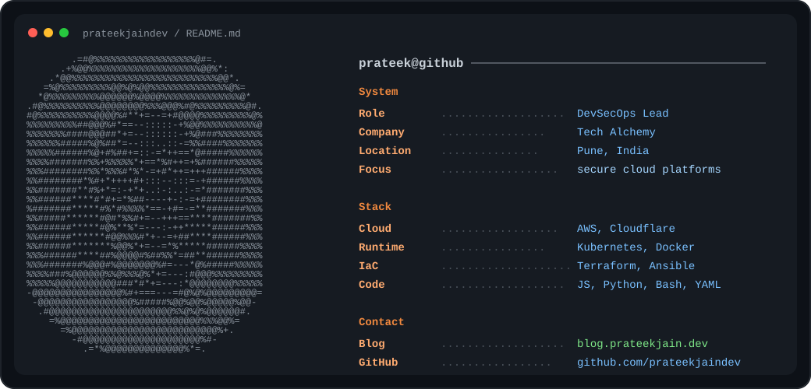

  

  <a href="https://blog.prateekjain.dev">Blog</a> .
  <a href="https://twitter.com/PrateekJainDev">X / Twitter</a> .
  <a href="https://github.com/prateekjaindev?tab=repositories">Repositories</a>

## DevSecOps, Cloud, and Platform Engineering

I build secure delivery systems, cloud-native infrastructure, and developer platforms that make teams faster without making production fragile. My work lives around Kubernetes, CI/CD, observability, infrastructure as code, and practical security automation.

## What I Work With

## Featured Work

- [traefik-demo](https://github.com/prateekjaindev/traefik-demo) - reverse proxy and edge routing experiments
- [cloudflare-container-demo](https://github.com/prateekjaindev/cloudflare-container-demo) - Cloudflare container runtime exploration
- [docker-shrink](https://github.com/prateekjaindev/docker-shrink) - tooling and experiments around leaner containers
- [portfolio](https://github.com/prateekjaindev/portfolio) - personal site and project showcase

  
  

